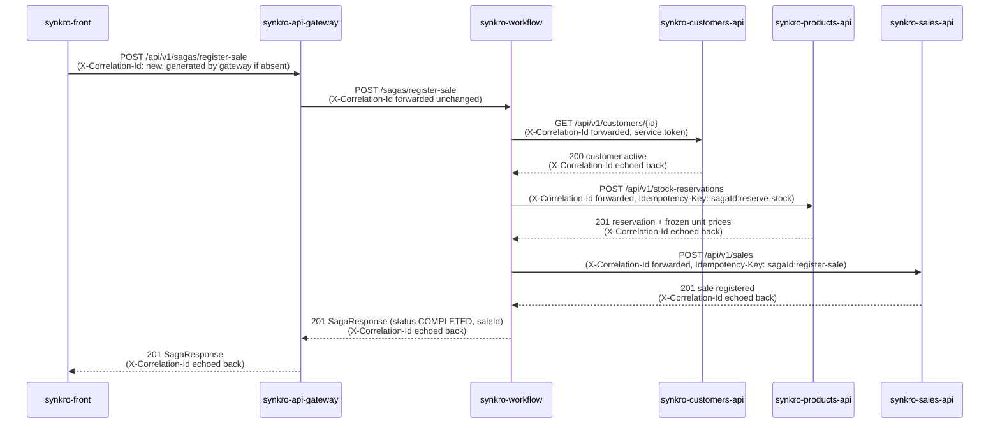

# CP1 — Critical Journey and Trace Propagation

## Chosen journey: Register a sale

`POST /api/v1/sagas/register-sale`

This is the system's single cross-domain write and the project's own North
Star metric ("average time to register a sale",
`03-product/problem-framing.md` §6). It crosses six real components:
`synkro-front`, `synkro-api-gateway`, `synkro-workflow`,
`synkro-customers-api`, `synkro-products-api` and `synkro-sales-api`.

> **Note on trace context.** SynkroTech does not use the W3C `traceparent`
> header. The team's own cross-cutting standard
> (`05-architecture/cross-cutting.md` §3) propagates `X-Correlation-Id` on
> every call, and that same value is exported as the trace ID to the
> OpenTelemetry collector (`05-architecture/deployment.md` §8). So in this
> document "trace context" = `X-Correlation-Id`.

---

## 1. Hop table

| Step | Calls | Receives | Protocol | Operation | Sync/Async | Data |
|---|---|---|---|---|---|---|
| 1 | `synkro-front` | `synkro-api-gateway` | REST | `POST /api/v1/sagas/register-sale` | sync | none (request body: customerId, lines) |
| 2 | `synkro-api-gateway` | `synkro-workflow` | REST | `POST /sagas/register-sale` | sync | saga state row (`workflow_schema`) |
| 3 | `synkro-workflow` | `synkro-customers-api` | REST | `GET /api/v1/customers/{id}` | sync | `customers_schema` (read only) |
| 4 | `synkro-workflow` | `synkro-products-api` | REST | `POST /api/v1/stock-reservations` | sync | `products_schema` (stock reservation + frozen unit prices) |
| 5 | `synkro-workflow` | `synkro-sales-api` | REST | `POST /api/v1/sales` | sync | `sales` database (MongoDB) |

There is no asynchronous hop in this journey: the MVP has no message broker
(`09-microservices/communication-patterns.md`, Pattern 4; ADR-007 Decision
5). Every step is a synchronous REST call with the workflow's own service
token, and the saga's state is persisted in `workflow_schema` after each
step so it can resume if the process restarts
(`05-architecture/decisions/records/ADR-007-persistent-saga-and-scheduled-work.md`).
If step 4 or step 5 fails as a business rejection, the workflow compensates
with `POST /api/v1/stock-reservations/{id}/release`, which is idempotent.

---

## 2. Sequence diagram



Every arrow in both directions carries the same `X-Correlation-Id`: it is
generated once (by `synkro-front` if it sends one, otherwise by
`synkro-api-gateway`), forwarded unchanged on every outgoing call, and
echoed back on every response, exactly as `cross-cutting.md` §3 defines it.
That single value is what lets five independent services' logs be read
back as one story for one request.

---

## 3. Span tree

All spans below share the same `trace_id` (= the request's
`X-Correlation-Id`). Indentation shows the parent/child relationship.

```
- span: POST /api/v1/sagas/register-sale  [synkro-api-gateway]  (root span)
  trace_id: 9f1e2a7b-...   span_id: a1b2c3d4
    - span: POST /sagas/register-sale  [synkro-workflow]  (child of root)
      trace_id: 9f1e2a7b-...   span_id: b2c3d4e5   parent_span_id: a1b2c3d4
        - span: GET /api/v1/customers/{id}  [synkro-customers-api]  (child)
          trace_id: 9f1e2a7b-...   span_id: c3d4e5f6   parent_span_id: b2c3d4e5
        - span: POST /api/v1/stock-reservations  [synkro-products-api]  (child)
          trace_id: 9f1e2a7b-...   span_id: d4e5f6a7   parent_span_id: b2c3d4e5
        - span: POST /api/v1/sales  [synkro-sales-api]  (child, same trace_id, crosses the service-token boundary)
          trace_id: 9f1e2a7b-...   span_id: e5f6a7b8   parent_span_id: b2c3d4e5
```

**On the "asynchronous boundary" span asked for by the guide:** this
journey has none, because SynkroTech's MVP has no broker — every hop above
is a synchronous REST call, confirmed by `communication-patterns.md`
Pattern 4 and ADR-007 Decision 5. The span that comes closest to a
"boundary crossing" is `POST /api/v1/sales` on `synkro-sales-api`: it is
the only step that crosses from the shared PostgreSQL side of the system
(customers, products, the saga store) into the separate MongoDB store
that only Sales owns (ADR-010). It is still synchronous and still shares
the same `trace_id` as every other span in the tree — there is simply no
queue or broker in between to call an "async boundary". If a message
broker is adopted post-MVP (`05-architecture/overview.md` §8, "Planned
Evolution"), that is the hop where an async span would first appear,
since it is already the point where one storage technology hands off to
another.

---

## References

* Saga call order and compensation → `09-microservices/communication-patterns.md` Pattern 3
* Trace context propagation → `05-architecture/cross-cutting.md` §3
* Saga persistence and no-broker decision → `05-architecture/decisions/records/ADR-007-persistent-saga-and-scheduled-work.md`
* Contract for the saga's public endpoint → `07-api/contracts/openapi/synkro-workflow.yaml`
* Contracts for the three internal calls → `07-api/contracts/openapi/synkro-customers-api.yaml`, `synkro-products-api.yaml`, `synkro-sales-api.yaml`
* North Star metric this journey measures → `03-product/problem-framing.md` §6
