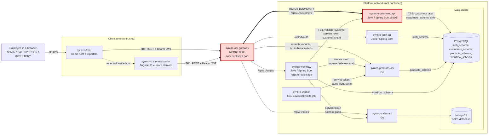

# CP1 — Attack Surface Map and Trust Boundaries

**Author:** Jordan Ramirez Gallego (@JordanRG420)
**System:** SynkroTech sales management system (`synkro-tech`)
**My boundary:** `synkro-api-gateway` -> `synkro-customers-api` (TB2)

Sources in the team docs repository: `09-microservices/service-catalog.md`,
`01-context/overview.md`, `07-api/authentication.md`,
`07-api/contracts/openapi/synkro-customers-api.yaml`, ADR-004, ADR-006, ADR-007,
ADR-008, ADR-009, ADR-010, ADR-011.

## 1. Data-flow diagram

There is no message broker and no external API in the MVP: ADR-007 removed
RabbitMQ and the `SaleCompleted` / `SaleFailed` events, and no service calls a
third-party provider.

## 2. Trust boundaries

| ID | From -> To | Why it is a boundary |
|---|---|---|
| TB1 | Browser (`synkro-front`, `synkro-customers-portal`) -> `synkro-api-gateway` | Data enters from devices the team does not control |
| **TB2** | **`synkro-api-gateway` -> `synkro-customers-api`** | **The gateway only checks that `Authorization` is present; customers-api must validate the RS256 token and the role itself (ADR-006)** |
| TB3 | `synkro-workflow` -> `synkro-customers-api` | Internal call that does not pass through the gateway; it carries a service token |
| TB4 | Services -> PostgreSQL / MongoDB | Each service reaches only its own schema or database |
| TB5 | `synkro-customers-api` -> `customers_schema` | Role `customers_app`, limited by `GRANT` to its schema |

## 3. Asset inventory (Customers domain)

| Asset | Where it lives | Classification |
|---|---|---|
| `identityDocument` (cédula / NIT) of a `Customer` | `customers_schema.customer`; crosses TB2 in the query string of `GET /api/v1/customers?identityDocument=` and in the body of `POST` / `PUT` | Restricted |
| Person access JWT (`sub`, `roles`, `permissions`, `jti`) | `Authorization` header crossing TB1 and TB2; valid for 1 hour | Restricted |
| Workflow service token (`customers:read`) | `synkro-workflow`, crossing TB3; valid for 30 days | Restricted |
| `name`, `email`, `phone`, `address` of a `Customer` | `customers_schema.customer`; `CustomerResponse` crossing TB2 back to the browser | Confidential |
| `Idempotency-Key` records of customer creation | `customers_schema.idempotency_key` | Internal |
| `active` and `registeredAt` of a `Customer` | `customers_schema.customer` | Internal |
| `X-Correlation-Id` | Headers and JSON logs of the gateway and of customers-api | Internal |
| JWT public key (`JWT_PUBLIC_KEY`) | Configuration of `synkro-customers-api` | Public |

## 4. Entry points of TB2

Every route below is published by the gateway under `/api/v1/customers` and
forwarded unchanged to `synkro-customers-api:8080`.

| Entry point | Who calls it | How it authenticates today |
|---|---|---|
| `GET /api/v1/customers` (`identityDocument`, `active`, `page`, `limit`) | ADMIN, SALESPERSON from the customers portal and the point of sale | Gateway: `401` if `Authorization` is missing. customers-api: RS256 signature, `exp`, `sub`, role; INVENTORY gets `403` |
| `POST /api/v1/customers` + `Idempotency-Key` | ADMIN, SALESPERSON | Same as above |
| `GET /api/v1/customers/{id}` | ADMIN, SALESPERSON (the workflow reaches it through TB3, not TB2) | Same as above |
| `PUT /api/v1/customers/{id}` | ADMIN, SALESPERSON | Same as above |
| `DELETE /api/v1/customers/{id}` (soft deactivation, `active = false`) | ADMIN, SALESPERSON | Same as above |

Controls already in the gateway for this route: rate limit with `429` and
`Retry-After`, CORS only for the `synkro-front` origin, and a new
`X-Correlation-Id` created by the gateway when the client sends none. `X-User-*` headers are never
trusted by customers-api; identity comes only from the token claims.

## 5. Observations for CP2

- `identityDocument` travels in the query string, so it can be written to the gateway access log.
- `GET /api/v1/customers` without filters lets an ADMIN or SALESPERSON page through every customer.
- The `customer` table stores no author of an update or a deactivation.
