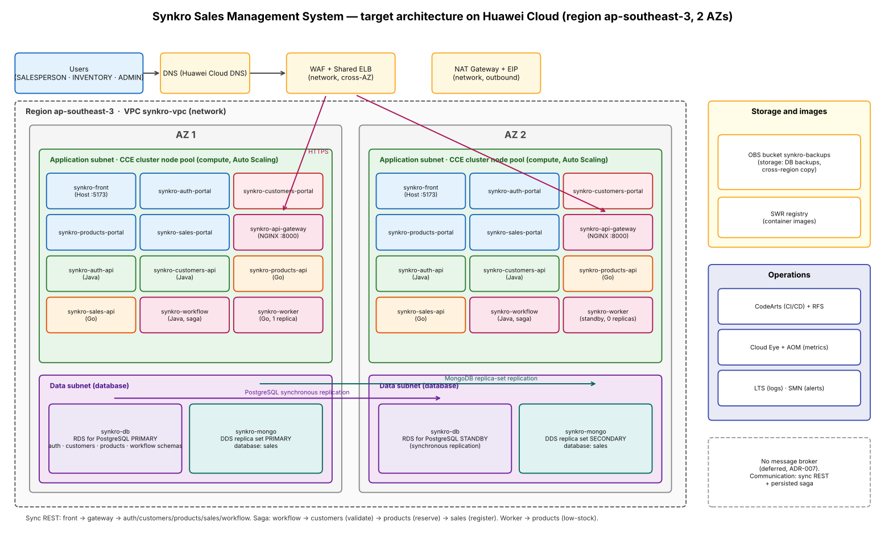

# Architecture design note — Synkro

## 1. Target architecture

The system keeps its current style (one hexagonal microservice per bounded context, one gateway, a persisted saga) and moves it to Huawei Cloud in region ap-southeast-3 across two availability zones. Containers run on CCE node pools in both AZs behind WAF and a shared ELB. PostgreSQL becomes RDS with a cross-AZ standby, MongoDB becomes a DDS replica set, backups go to OBS and images to SWR. The MVP has no message broker (ADR-007), so none is drawn.

The VPC has three subnet layers. A public subnet holds the ELB and the NAT Gateway, an application subnet holds the CCE nodes, and a data subnet holds RDS and DDS with no route from the internet. Security groups follow the existing rule that only the gateway and the host are reachable from outside, and that no domain service or database publishes a port. Each service keeps its own store and credentials, as ADR-009 and ADR-010 require.

| Component in the diagram | Defined in (file of your team's -docs) |
|---|---|
| synkro-front (Host) and the four portals | 05-architecture/overview.md |
| synkro-api-gateway | 05-architecture/overview.md |
| synkro-auth-api, synkro-customers-api | 05-architecture/overview.md |
| synkro-products-api, synkro-sales-api | 05-architecture/overview.md |
| synkro-workflow (saga) | 05-architecture/pattern-guide.md |
| synkro-worker | 05-architecture/overview.md |
| synkro-db (PostgreSQL, four schemas) | 06-data/models.md |
| synkro-mongo (database sales) | 06-data/models.md |
| Ports, networks and environments | 05-architecture/deployment.md |
| Backups in OBS | 13-operations/backup-and-recovery.md |

## 2. Five principles

| Principle | Current weakness | Evidence in -docs | Design decision | Huawei Cloud service |
|---|---|---|---|---|
| Reliability | One PostgreSQL instance is a single point of failure, and the MongoDB single-node replica set gives no failover. | 05-architecture/overview.md (AT-002) | Run every service in two AZs, give synkro-db a synchronous standby and sales a three-member replica set. | RDS for PostgreSQL HA, DDS, ELB |
| Security | Service tokens are rotated by hand and secrets live in protected environment files. | 05-architecture/security-threat-model.md | Keep JWT validation in every service, move secrets out of files and filter traffic at the edge. | WAF, DEW, IAM |
| Performance efficiency | There is no cache, and one gateway rate limit applies to all traffic. | 05-architecture/overview.md (section 8) | Scale stateless pods by CPU and add a cache only if product reads become the bottleneck. | CCE HPA, ELB, DCS (later) |
| Cost | Fixed Docker Compose sizing wastes capacity off-peak, and a second database engine adds operating cost. | 05-architecture/deployment.md | Pay-per-use nodes with a small minimum, one managed engine per workload and lifecycle rules on backups. | CCE Cluster Autoscaler, OBS lifecycle |
| Operations | There is no hosted automatic deployment and no measured RTO or RPO. | 10-devops/ci-cd.md | Describe the infrastructure as code, deploy through a pipeline and alert on metrics and logs. | RFS, CodeArts, Cloud Eye, LTS, SMN |

Cost deserves a separate remark: the second AZ and the standby database roughly double the data-layer price, and the design accepts that in exchange for a zero RPO. The five decisions reinforce each other. Two AZs remove the single points of failure, the autoscaling rules keep the cost proportional to traffic, and the infrastructure code makes every change repeatable and auditable. Each weakness above is already recorded by the team, so the design answers documented debt rather than a generic checklist.

## 3. Scalability

The current Docker Compose composition runs one container per service, so a traffic peak can only be absorbed by a larger machine. On Huawei Cloud the same images run as several identical pods, which is horizontal scaling on the X axis of the AKF cube. Because each service validates its own JWT and keeps no session in memory, any pod can answer any request and ELB can balance freely.

All stateless services run as CCE deployments behind a Horizontal Pod Autoscaler, and the node pool grows with the Cluster Autoscaler between 2 and 6 nodes. Sales traffic is the first to rise during promotions, so Sales and Products scale earliest. Workflow scales more slowly because it owns persisted sagas.

| Service | Scaling metric | Threshold (number and unit) | Min instances | Max instances |
|---|---|---|---|---|
| synkro-sales-api | Average CPU utilization | 65 % | 2 | 6 |
| synkro-products-api | Average CPU utilization | 70 % | 2 | 6 |
| synkro-workflow | Average CPU utilization | 60 % | 2 | 4 |

synkro-worker is not scaled: it runs one replica because its low-stock run uses run-scoped keys. The other services keep a minimum of two pods, one per AZ, so losing an AZ never removes a service. Scale-out reacts after the metric stays above the threshold for one minute, and scale-in waits five minutes to avoid flapping. The same rules apply to Auth and Customers, which start at two pods and are not listed because their load stays low. Cloud Eye alarms notify the team through SMN when a service reaches its maximum, so the limits are reviewed instead of silently capping capacity.

## 4. Disaster recovery

- Critical data store: synkro-db (PostgreSQL), because it holds authentication, customers, products and the saga state.
- RTO: 5 minutes
- RPO: 0 minutes
- DR pattern (chapter 11): Solution 4, on-cloud intra-region active-active across two AZs (RDS primary and standby, ELB health checks).
- Why the pattern meets those numbers: RDS replicates to the standby synchronously, so every committed transaction exists in both AZs and the RPO is zero, which a daily backup could never reach. ELB health checks and the RDS automatic failover complete in seconds to a couple of minutes, which fits inside a 5-minute RTO.

When an AZ fails, ELB stops sending traffic to its pods, RDS promotes the standby in the healthy AZ, and the DDS replica set elects a new primary there. The operator then checks that the saga records in workflow_schema are consistent before the failed AZ is brought back. The recovery order is fixed: database first, then Workflow, then the domain services and finally the gateway. Nightly RDS backups copied to OBS cover logical corruption, which replication would copy as well. A regional disaster is accepted as residual risk for the MVP, because a two-city design would raise the cost.

## 5. Automated deployment

| Stage | Trigger | Tool or service | File in your team's repositories |
|---|---|---|---|
| Build | Push or pull request to develop, qa or main | CodeArts Build (GitHub Actions today) | .github/workflows/ci.yml |
| Test | Same trigger | CodeArts Check and test, owner CI jobs | .github/workflows/ci.yml, .github/workflows/db-ci.yml |
| Image | Merge to a permanent branch or release tag | Docker build, push to SWR | Dockerfile |
| Deploy to qa | Merge to qa | RFS stack update from a Terraform template | deploy/huaweicloud/main.tf (new, in synkro-infra-postgres) |
| Deploy to production | Release tag approved by the code owner | RFS stack update and CCE rolling update | compose.yml and deploy/huaweicloud/main.tf (synkro-infra-postgres) |
| Rollback | Failed health check after deploy | Previous image tag, RFS previous template, RDS restore | scripts/synkro.py (restore command, synkro-infra-postgres) |

The pipeline follows the existing branch flow of develop, qa and main, and production deploys only from an approved release tag. Every stage writes its result to the pipeline log, so a deploy can be traced to a commit, an image tag and an RFS stack version. A deploy is considered healthy when the ELB health checks of all pods pass and the gateway answers its health route. Database migrations run first through the owner runners and are never edited after applying, so a rollback prefers a forward fix and uses a verified backup only when needed. The `deploy/huaweicloud/main.tf` template does not exist yet and is part of this design.

## 6. Decisions

The two decisions below are the ones that change the most compared with the current Compose deployment. Both are recorded as proposals, because neither has been executed on a real Huawei Cloud account yet.

- [ADR-C3-01](ADR-C3-01.md): use RDS for PostgreSQL with a synchronous cross-AZ standby for synkro-db (section 4).
- [ADR-C3-02](ADR-C3-02.md): describe and deploy the Huawei Cloud infrastructure with RFS Terraform templates (section 5).